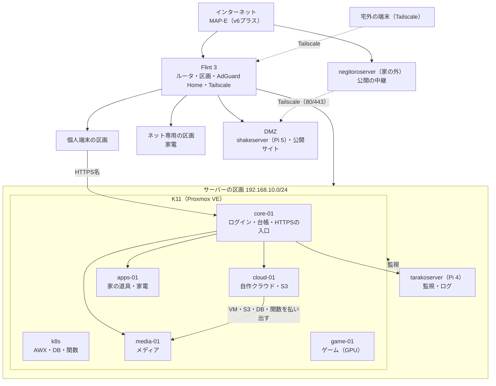

# ホームラボの全体像

> **更新日** 2026-10-22 ・ **区分** 設計 ・ **読む人** 管理者・開発者

**Proxmox VE の1台（K11、ホスト名 `apextox`）に役割ごとの VM を分け、自作のプライベートクラウド `shakecloud` で VM・S3・DB・関数を払い出し、ログインを Authentik に集めています。** ルータ・監視・公開サイトは K11 の外の機械に置いています。

| 知りたいこと | ページ |
| --- | --- |
| どの VM で何が動いているか | [サービス図](../service-map.md)・[配備台帳](../operations/handover.md) |
| URL | [接続先一覧](../reference/urls.md) |
| 区画とファイアウォール | [ネットワーク図](../network-map.md)・[区画と区画間の通信](../operations/vlan.md) |
| 守り | [セキュリティ](security.md) |
| 止まったら何が困るか | [障害モード](failure-modes.md) |
| 残っている作業 | [GitHub Issues](https://github.com/rurutheGeek/shake-cloud/issues) |

## 1. 役割と機械

| 役割 | 機械 | 中身 | 詳しく |
| --- | --- | --- | --- |
| 仮想化 | K11（Ryzen 9 8945HS・RAM 約60GiB・SSD 1TB） | Proxmox VE。全 VM と GPU パススルー | [Proxmox導入後の進め方](../operations/bring-up.md) |
| ルータ | Flint 3（物理機） | MAP-E・DHCP・DNS（AdGuard Home）・区画・Wi-Fi・Tailscale | [Flint 3](../operations/flint3.md) |
| ログイン・台帳・入口 | core-01 | Authentik・NetBox・HTTPS の入口（Caddy） | [認証基盤](../operations/identity.md)・[HTTPSの入口](../operations/edge.md) |
| 自作クラウド | cloud-01 | shakecloud の API・ポータル・管理DB・Garage（S3） | [最小クラウド](cloud.md)・[クラウドの使い方](../services/cloud.md) |
| クラスタ | k8s-cp-01（1台で常時稼働。worker-01・02 は停止した予備） | AWX・CloudNativePG（database）・Knative（function） | [Kubernetes](../operations/kubernetes.md) |
| 家の道具・家電 | apps-01 | Homarr・Vaultwarden・Home Assistant・CUPS・pkdb・Bot・このサイト | [サービスの置き場所](../operations/services.md) |
| メディア | media-01 | Nextcloud・Kavita・Navidrome・FreshRSS・MeTube・Forgejo・UrBackup | [Nextcloud](../operations/nextcloud.md) |
| ゲーム | game-01 | GPU を使うゲーム配信（スタックは別の担当者。Wolf・RomM は準備中） | [ゲーム・開発VM](gaming.md) |
| 監視 | tarakoserver（Pi 4、K11 の外） | Prometheus・Alertmanager・Grafana・Loki・ネットワーク図・UPS | [監視](../operations/monitoring.md) |
| 公開サイト | shakeserver（Pi 5、DMZ） | 公開サイト・Minecraft | [公開サイト](../operations/web.md) |
| 公開の中継 | negitoroserver（Pi Zero 2 W、家の外） | Cloudflare から受けて tailnet で DMZ へ。外からの監視 | [公開サイト](../operations/web.md) |
| 開発 | dev-01・dev-02 | 開発と自動化の実行 | [開発参加ガイド](../onboarding.md) |

**作り方は2通りです。** 基盤 VM（core-01・cloud-01・k8s）は Terraform（`platform/terraform/hosts.yaml`）、サービス VM（media-01・apps-01・game-01 など）は自作クラウドの Terraform Provider（`platform/terraform/services/<name>/`）が作ります。IP はどちらも NetBox から採番します（[IaCの所有境界](iac.md)）。

## 2. 自作しているもの

既製ソフトはそのまま使い、足りない部分・運用の自動化・機器連携を自作しています。

| 自作部分 | 場所 | 何をする |
| --- | --- | --- |
| shakecloud | `cloud/` | VM・S3・DB・関数を払い出す API（正本は `cloud/openapi/shakecloud.yaml`）、CLI、Terraform Provider、ポータル、MCP |
| ルータの設定 | `platform/flint3/` | Flint 3 の純正ファームに足す設定（区画・DMZ・Tailscale の経路・設定崩れの点検） |
| ログインの設定 | `stacks/identity/` | グループ・OIDC クライアント・Forward Auth・招待・メール復旧・パスキーを冪等に整える |
| Nextcloud 連携 | `stacks/media/nextcloud/apps/` と公開リポジトリ | 印刷（`cups_print`）・LocalSend 送信（`localsend_share`）・タグ編集（`shake_tags`） |
| 印刷・転送の橋渡し | `stacks/print-api/`・`stacks/localsend-send/` | Nextcloud → CUPS、Nextcloud → 端末 |
| 音楽ライブラリ | `stacks/music-tools/` | タグ編集 API、ライブラリ整理、同期 |
| 共有 RSS | `stacks/media/freshrss/extensions/` | 全員で1つの購読リストを共有する拡張 |
| 家電の連携 | `stacks/home-assistant/`・`stacks/eufy-leo-rtc/` | HA の SSO と配備、Eufy カメラのライブ映像の自前実装 |
| 監視 | `stacks/monitoring/`・`stacks/touch-panel/` | 収集と警告の規則、おとり、タッチパネル |
| ポケモンDB | `stacks/pkdb/` | PostgreSQL・登録画面・MCP サーバ |
| 配備・検証 | `platform/ansible/`・`tools/`・`tests/` | 配備、実機プローブ、公開前検査、テスト |

## 3. 決めごと

- **コードにできるものはすべてコードにする。** 残る手作業は[初回セットアップの順番](../operations/bootstrap.md)に理由付きで並べる。
- **秘密値は Git に置かない。** 配備前に要るものは SOPS + age で暗号化し、ほかは配備先で生成する（[秘密値の管理](../operations/secrets.md)）。
- **ログインは2系統。** ブラウザは Authentik、機械はアクセスキー。Authentik が止まっても Terraform・CLI は動く（[セキュリティ §3](security.md#3-認証と資格情報)）。
- **インターネットからは公開サイトだけ。** 家のルータにポート転送は無く、公開サイトは家の外の中継から tailnet で DMZ へ入る（[セキュリティ §1](security.md#1-外から届く経路)）。
- **同じディスク上の写しはバックアップに数えない。** Garage も単一ノードなので唯一の保管先にしない（[バックアップ](../operations/backup.md)）。

決めたことの一覧と理由は[決定ログ](decisions.md)にあります。
