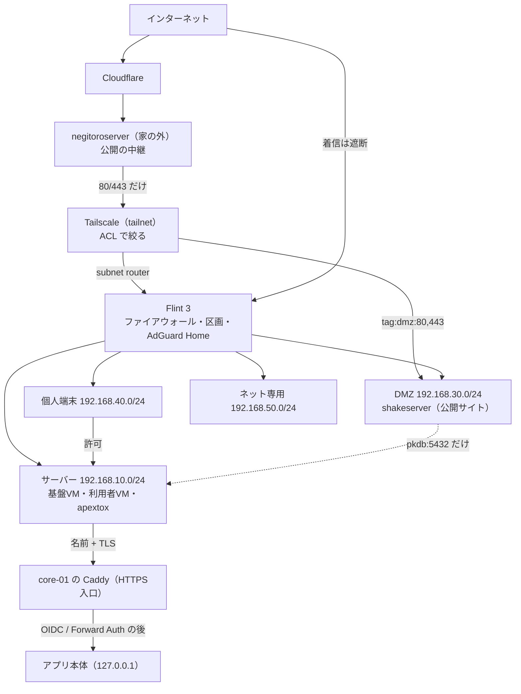

# セキュリティ（信頼境界と対策）

> **更新日** 2026-10-22 ・ **区分** 設計 ・ **読む人** 管理者・開発者

**状態**: 境界は Flint 3（2026-10-14〜）。区画（サーバー・DMZ・個人端末・ネット専用・AdGuard なし・ゲーム）は実機で分離済み。公開サイトは DMZ の shakeserver（2026-10-16〜）。DMZ にクラウドVMを置くには K11 の `vmbr0` の VLAN 対応が要る（いまは置いていないので困っていない）。

**家庭内の2人運用が前提です。** 組織の監査要件、内部犯行への耐性、規制対応は想定していません（[§6](#6-守らないと決めたこと)）。

## 1. 外から届く経路

**家のルータにポート転送はありません。** 外から家の中へ入る経路は、どれも Tailscale を通ります。

| 経路 | 入口 | 届く先 | 絞っているもの |
| --- | --- | --- | --- |
| 公開サイト（`*.ruruthegeek.dpdns.org`） | Cloudflare（WAF・レート制限）→ negitoroserver（Raspberry Pi Zero 2 W、**家の外**）の nginx stream（443）・sslh（80） | tailnet 経由で DMZ の shakeserver（Pi 5）の 80/443 だけ | negitoroserver の ufw は 80/443 を Cloudflare のアドレスだけ、SSH を tailnet だけ。Tailscale ACL（`tag:relay` → `tag:dmz:80,443`）。negitoroserver はサブネットルートを持たない |
| 宅外からの管理・利用 | Tailscale → Flint 3 の subnet router | サーバーの区画（`192.168.10.0/24`）。個人端末の区画は 2026-10-17 から流さない | Tailscale ACL（`platform/tailscale/acl.json`）。タグの付いた機器は決めた先だけ |
| `apextox.dpdns.org` の名前 | Cloudflare の公開DNS | **応答だけ**。中身は内部IP（`192.168.10.x`）なので外からは届かない | — |

内部IPを公開DNSに書いているのは、**証明書をDNS-01で取るためだけ**です。`home.arpa` と自前CAにしなかったのは、全端末へCAを登録する手間と、スマートフォンのアプリが自前CAを信用しない問題を避けるためです。代償として、名前の一覧と内部IPの割り当ては外から推測できます（[決定ログ](decisions.md)）。

## 2. 信頼境界

| 境界 | 通すもの | 止めるもの |
| --- | --- | --- |
| インターネット → 家 | 返りの通信だけ | 着信すべて。ポート転送なし。IPsec を通す GL.iNet の初期ルールも削除済み |
| 区画 → 区画 | [区画間の通信](../operations/vlan.md#区画間の通信)の表にあるものだけ | それ以外。既定は拒否 |
| サーバーの区画の中 → core-01・cloud-01 | `platform/terraform/firewall.yaml` に書いた口だけ | それ以外（Garage の管理API・RPC、core-01 の CUPS など）。Proxmox の VM ファイアウォールで落とす |
| DMZ → 家の中 | pkdb（apps-01:5432）だけ | それ以外。Flint 3・Pi 5 の nftables・apps-01 のセキュリティグループの3か所で止める（[§4](#4-対策の一覧)） |
| 端末 → 名前解決 | Flint 3 の AdGuard Home（ブロックリスト付き） | ブロックリストに載った名前。AdGuard なしの区画（ソーナノWiFi）は 1.1.1.1 へ直接 |
| 端末 → HTTPS入口 | 名前が一致するTLS接続 | 証明書の名前に無いホスト。core-01 の Caddy は catch-all で Authentik へ渡す |
| HTTPS入口 → アプリ | 認証を通したリクエスト | アプリ本体は `127.0.0.1` に閉じており、入口を経由しないと触れない |
| 利用者 → 他人のVM | 一覧の閲覧（所有者名・イメージ・割り当て・状態） | 電源・削除・サイズ変更は403。他人の `client_token` は返さない。`user_data` は一覧に出さない |
| クラウドAPI → Proxmox | `cloudapi@pve` に割り当てたロールの範囲 | それ以外。利用者は Proxmox の資格情報を持たない |
| 実行環境 → Git | コード・設定例・Markdown・digestロック・SOPS暗号文 | `.env`、Cookie、CA秘密鍵、実データ、state |

**ルータの管理画面にだけSSOを付けていません。** Flint 3 自身のパスワードで守り、Authentik を通しません。**ルータは復旧経路だから**で、Authentik（core-01）が止まっているときに開けなくなると詰みます。AdGuard の管理画面は復旧に必須ではないので Forward Auth を通します。

**HTTPSの入口は core-01 の1台です。** Cloudflare の DNS 編集トークンを持つVMは core-01 だけです（ほかに Proxmox ホストと k8s の cert-manager）。代償として、core-01 が止まるとHTTPS名ではどのサービスにも入れません（[HTTPSの入口](../operations/edge.md)）。

## 3. 認証と資格情報

**ブラウザと機械を別系統にしています。**

| 経路 | 使うもの | 止まったときの影響 |
| --- | --- | --- |
| ブラウザ | Authentik の OIDC（パスキー・パスワード＋認証器） | Authentik（core-01）が落ちるとブラウザから入れない |
| Terraform・CLI・スクリプト | アクセスキー `sca_<キーID>.<秘密値>` を `Authorization: Bearer` で | **Authentikが落ちても動く。** これが分けている理由 |
| OIDC非対応のアプリ | 入口での Forward Auth（Navidrome・MeTube・CUPS・AdGuard・netmap など） | 入口が落ちるとアプリにも届かない |
| AI のクライアント（ポケモンDBの MCP） | Authentik を認可サーバにした OAuth 2.1（PKCE の公開クライアント） | Authentik が落ちると新しいトークンが取れない |

`admins` だけに開けているもの: ネットワーク図（netmap）・監視のタッチパネル・Botポータル・ポケモンDBの登録画面と MCP・Adminer。グループの意味は[認証基盤](../operations/identity.md)。

アクセスキーの扱い:

- **発行はポータルのログインからだけ。** アクセスキーで別のアクセスキーは作れません。漏れたキーが自分の複製を作って居座れないようにするためです。
- 1アカウント5本まで。削除は行を残して無効化します。表示は発行時の一度だけ。
- ブートストラップ管理キーは2026-09-11に無効化済みです。緊急時は cloud-01 で `manage.py rotate-bootstrap-key`。

アカウントの同一性:

- Authentik の `sub` は `user_uuid` を使います。プロバイダを作り直しても変わらないためです。
- **知らない `sub` で既知のメールアドレスが来たらログインを拒否します**（`AccountConflict`）。黙って別アカウントを作ると、その人のリソースが2つに分かれるためです。

**SSOは権限の統合ではありません。** Vaultwardenは共通ログインを通しても保管庫を開くマスターパスワードが別に要ります。Nextcloudの共有設定はKavita・Navidromeへ継承されません（[Nextcloudのアクセス権限](../operations/nextcloud-permissions.md)）。

## 4. 対策の一覧

「正本」はその対策を実際に入れているコードです。文書と食い違ったらコードが正しい。

| 層 | 対策 | 正本 | 手順・詳細 |
| --- | --- | --- | --- |
| 境界 | 区画とファイアウォール。WPS 無効、IPsec の初期ルール削除。個人端末の区画からの管理画面・SSH はデスクトップ（有線の MAC）だけ | `platform/flint3/rootfs/etc/shakecloud/apply-segments` | [Flint 3](../operations/flint3.md)・[区画](../operations/vlan.md) |
| 境界 | 設定崩れを5分ごとに点検して警告（`RouterConfigDrift`）。設定を毎日 K11 へ取り、差分を Git に残す | `stacks/netmap/app/checks.py`・`flint3-backup.timer` | [Flint 3](../operations/flint3.md) |
| DMZ | DMZ → 家の中は pkdb だけ。送信元は `dmz-db-clients` に書いたアドレスだけ | `platform/flint3/rootfs/etc/shakecloud/apply-dmz` | [区画](../operations/vlan.md#dmz-の作り方) |
| 公開の手前 | Cloudflare はフル（厳密）・TLS1.2 以上、WAF のマネージドルールと走査の遮断、レート制限 | `platform/terraform/25-edge/` | [公開サイト](../operations/web.md#cloudflare-での守り) |
| 公開の中継 | negitoroserver の ufw。80・443 は Cloudflare のアドレスだけ、SSH は tailnet だけ | `platform/ansible/roles/relay/`（`relay_cloudflare_ranges`） | [公開サイト](../operations/web.md) |
| DMZ | Pi 5 自身も家の区画への送信を落とす（`inet homeguard`。Docker の転送も対象） | `platform/ansible/host_vars/shakeserver.yml` の `pi_base_lan_guard` | [公開サイト](../operations/web.md) |
| DMZ | pkdb 側も Pi 5（`192.168.30.12/32`）だけ受ける | `platform/terraform/services/apps/main.tf` の `pkdb_dmz` | [pkdb](../operations/pkdb.md) |
| 公開サイト | root ではないユーザー（`shakeweb`）の Podman で動かす。SSH は鍵のみ、`unattended-upgrades`、nginx のセキュリティヘッダと TLS1.2 以上、アプリは `127.0.0.1`。イメージは CI がビルドし、読み取り専用のマシンユーザーで GHCR から取る | `platform/ansible/roles/shake_web/`・`stacks/shake-web/` | [公開サイト](../operations/web.md) |
| 宅外 | tailnet のタグごとに届く先を決め、ポリシーに `tests` を書いて誤りを弾く | `platform/tailscale/acl.json` | [Tailscale](../operations/net.md)・`platform/tailscale/README.md` |
| HTTPS | 証明書と DNS 編集トークンは入口の1台だけ。後ろへは内部CAの HTTPS で中継 | `platform/ansible/roles/tls_proxy/`・`platform/terraform/dns.yaml` | [HTTPSの入口](../operations/edge.md) |
| 認証 | Authentik の OIDC・Forward Auth・パスキー・メールの確認コード・招待制 | `stacks/identity/configure.py`・`invitations.py` | [認証基盤](../operations/identity.md) |
| クラウドAPI | CSRF（`http.CrossOriginProtection`）、WebSocket の Origin 検査、コンソールURLは5分・アカウントに結び付け・ログに出さない、`Cache-Control: no-store`、noVNC 同梱で CSP `script-src 'self'` | `cloud/api/internal/server/` | [クラウドAPI本体](../operations/cloud-api.md) |
| クラウドAPI | 監査ログは追記専用（トリガーで UPDATE・DELETE・TRUNCATE を拒否） | `cloud/api/internal/db/` | [クラウドの使い方](../services/cloud.md) |
| 基盤VM | core-01・cloud-01 の受信は書いた口だけ（受信の既定は拒否、送信は許可） | `platform/terraform/firewall.yaml`・`modules/vm-firewall/` | [区画](../operations/vlan.md#同じ区画の中基盤vmの受信) |
| 利用者VM | セキュリティグループ（VM 単位のFW）。データセンターFWは有効、ホストFWは無効、MAC 偽装は `ebtables` で止める。API の起動のたびにグループを持つ VM のFWを書き直す | `platform/terraform/00-bootstrap/firewall.tf`・`cloud/api/internal/compute/firewall.go` | [ボリューム・S3・DB・関数](../operations/cloud-resources.md) |
| 利用者VM | SSH 鍵は公開鍵だけを保存し、NoCloud の `meta-data` で渡す。`user-data` は seed ISO に平文で入るので秘密の置き場として案内しない | `cloud/api/internal/` | [クラウドの使い方](../services/cloud.md) |
| 秘密値 | SOPS + age（受信者2本）。配備時に VM 上で生成する値は Git に入れない。公開前に `tools/check-publication.py` | `.sops.yaml`・`platform/sops/` | [秘密値の管理](../operations/secrets.md) |
| 検知 | おとり（`192.168.10.250`、21・22・23・80・445・3306・3389・5900・8080）。触られたら Discord へ緊急で通知（`CanaryTouched`） | `stacks/monitoring/canary/`・`stacks/monitoring/loki/rules/` | [監視](../operations/monitoring.md) |
| 検知 | おとり（`192.168.10.250`、21・22・23・80・445・3306・3389・5900・8080）。触られたら Discord へ緊急で通知（`CanaryTouched`） | `stacks/monitoring/canary/`・`stacks/monitoring/loki/rules/` | [監視](../operations/monitoring.md) |
| 検知 | Flint 3 の syslog と Pi の journal を Loki へ集める。公開サイトは家の外から見張る | `stacks/monitoring/` | [監視](../operations/monitoring.md) |
| 供給網 | 固定したイメージの脆弱性を毎日調べ、修正版のある重大なものを警告（`ImageCriticalVulnerability`）。Trivy と、ランタイムの版の照合 | `platform/ansible/roles/image_scan/` | [監視](../operations/monitoring.md) |
| 供給網 | イメージは `compose.lock.yaml` の digest で固定。CI で Go の `govulncheck`。`renovate.json`（GitHub App が入っていないと PR は作られない） | `stacks/*/compose.lock.yaml`・`.github/workflows/validate.yml` | [構成監査](../audits/config-audit-2026-09-16.md) |
| 中継コンテナ | `eufy-security-ws` は `172.31.254.1:3000`、eufy-leo-rtc の RTSP は `172.31.254.1:8554` にだけ bind し、LAN へは出さない | `stacks/eufy-leo-rtc/` ほか | [配備台帳](../operations/handover.md) |

## 5. 残っている穴

上から順に影響が大きいものです。次の一手と進み具合は Issue にあります。対処したら Issue を閉じ、この行を消します。

| 穴 | 起きうること | Issue |
| --- | --- | --- |
| **Proxmox（`:8006`・SSH）を送信元で絞っていない** | 個人端末の区画のどの端末からも管理画面に届く。ホストのFWは締め出しを避けるため無効（`firewall.tf` の説明） | [#219](https://github.com/rurutheGeek/shake-cloud/issues/219) |
| **利用者VMと基盤VMが同じL2、既定のセキュリティグループは全許可** | 利用者VMが侵害されると、同じ区画の機器へ直接届く（core-01・cloud-01 は VM ファイアウォールで口を絞った）。ARP スプーフィングで平文の通信も読める | [#224](https://github.com/rurutheGeek/shake-cloud/issues/224) |
| NetBox の書き込みトークンが平文HTTP（`:8000`）を流れる | 上の L2 の穴と組み合わさるとトークンが取れる（`:8000` に届くのはサーバーの区画だけ） | [#221](https://github.com/rurutheGeek/shake-cloud/issues/221) |
| print-api が `0.0.0.0` で bearer トークンを平文HTTPで受ける | 同上 | [#222](https://github.com/rurutheGeek/shake-cloud/issues/222) |
| Kubernetes に NetworkPolicy が無い | `functions`（利用者のコード）から `databases` へ届く | [#223](https://github.com/rurutheGeek/shake-cloud/issues/223) |
| 認証器（パスキー・確認コード）の登録が任意 | 認証器の無い利用者はパスワードだけで入れる | [#225](https://github.com/rurutheGeek/shake-cloud/issues/225) |
| DMZ からの侵入の検査が未実施 | 区画の規則の漏れに気づけない | [#220](https://github.com/rurutheGeek/shake-cloud/issues/220) |
| 外からのポートスキャンが未実施 | 意図せず開いている口に気づけない | [#220](https://github.com/rurutheGeek/shake-cloud/issues/220) |
| `cloud/.env.example` が `BIND_ADDRESS=0.0.0.0` | 例のまま手で配備すると平文APIが LAN に出る（Ansible は `127.0.0.1` で上書き） | [#226](https://github.com/rurutheGeek/shake-cloud/issues/226) |
| APIにレート制限が無い | 高コストな操作（12GiB のアップロード・VM 作成）を連打される | 後回し（LAN と tailnet だけ） |

元の指摘と経緯は[構成監査の未対応指摘](../audits/config-audit-2026-09-16.md)にあります。

## 6. 守らないと決めたこと

**ここに書いてあることは弱点であって、対策済みではありません。**

| 守らないもの | 理由と、成立する前提 |
| --- | --- |
| サーバーの区画の端末 | サーバーの区画に入った時点で、名前解決とHTTPS入口には届く。アプリの認証が最後の壁。**サーバーの区画（有線と管理用 Wi-Fi `porygon-…`）に知らない端末を入れないことが前提** |
| 物理ホストのroot | 取られたら全部が終わる。Proxmoxホストの鍵は人が管理し、コードで配らない |
| 内部構成の秘匿 | 名前と内部IPは公開DNSから引ける。証明書をDNS-01で取る代償として受け入れている |
| 内部犯行 | 2人とも `admins` に入りうる運用。操作は監査ログに残るが、権限で止めていない |
| 外部依存の停止 | Cloudflare（DNS）・DigitalPlat（ドメイン）・外部SMTPが止まると、証明書更新と招待・復旧メールが止まる（[障害モード](failure-modes.md)） |
| S3の冗長性 | Garageは単一ノード。**stateやバックアップの唯一の保管先にしない** |

## 7. 秘密値の置き場所

| 場所 | 入るもの |
| --- | --- |
| Git（`platform/sops/*.sops.yaml`） | 配備の**前に**必要な資格情報。SOPS + age で暗号化。キー名と構造は平文なので差分レビューができる |
| 各VMの `/opt/<stack>/secrets/` | 配備時に自動生成する値。Gitへは入らない。人に鍵を作らせない・変えさせない |
| core-01 の `oidc-cloud.json` | OIDCクライアントの秘密値の**正本**。SOPSへ複製しない（2か所に持つと作り直したとき食い違う） |
| Flint 3 の `/etc/shakecloud/porygon.key` | 管理用 Wi-Fi のパスワード。`apply-segments` がその場で作る |
| 手元だけ | `pve.ini`・`seed.ini`（NetBoxを最初に作るとき用）・`.local/pve-readonly.env`。`.example` から作る |

一覧と作り方は[秘密値の管理](../operations/secrets.md)、どのファイルに何が入っているかは[秘密値の管理 §7](../operations/secrets.md#where)にあります。

公開前の検査は `python3 tools/check-publication.py` です。既知の秘密値と禁止パス（`storage` `library` `backups` `runtime` `secrets` `trust` `.terraform`、`.env`、state）を検出しますが、**補助であって保証ではありません。** ステージした差分の目視確認も行ってください。

## 関連

- [区画と区画間の通信](../operations/vlan.md) — どの区画からどこへ通すかの表
- [Tailscale](../operations/net.md) — 宅外からの経路
- [公開サイト](../operations/web.md) — DMZ の Pi 5 と中継の守り
- [認証基盤](../operations/identity.md) — グループ・パスキー・復旧
- [秘密値の管理](../operations/secrets.md) — SOPS と age の手順
- [決定ログ](decisions.md) — ここに書いた方針の元になった決定
- [障害モードと単一障害点](failure-modes.md) — 止まったときに何が起きるか
