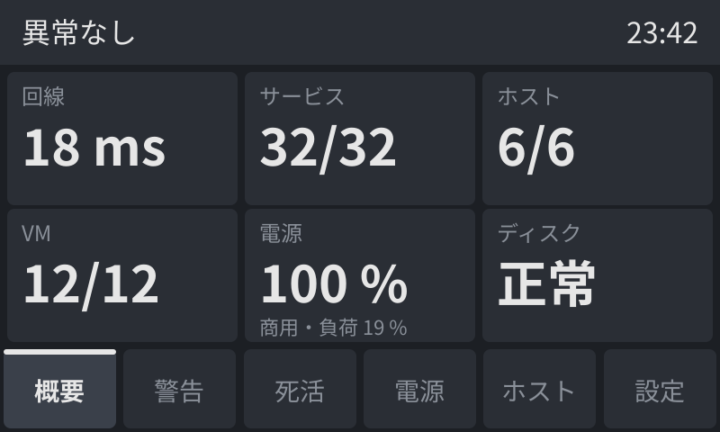
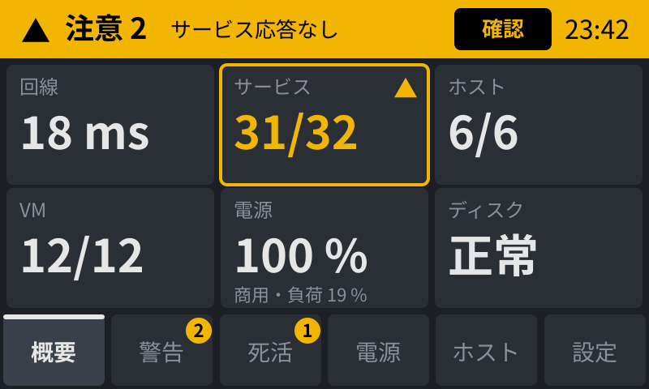
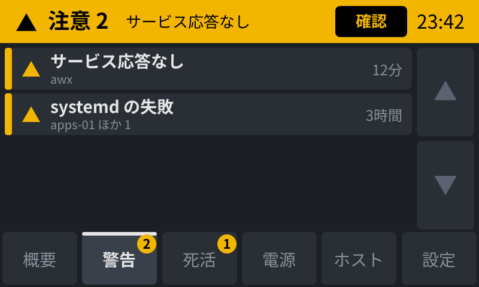
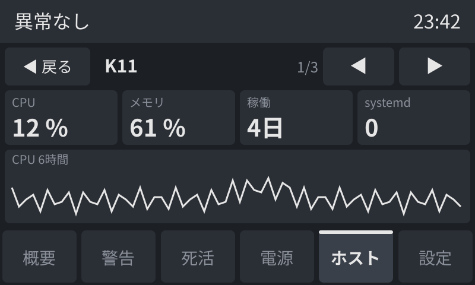
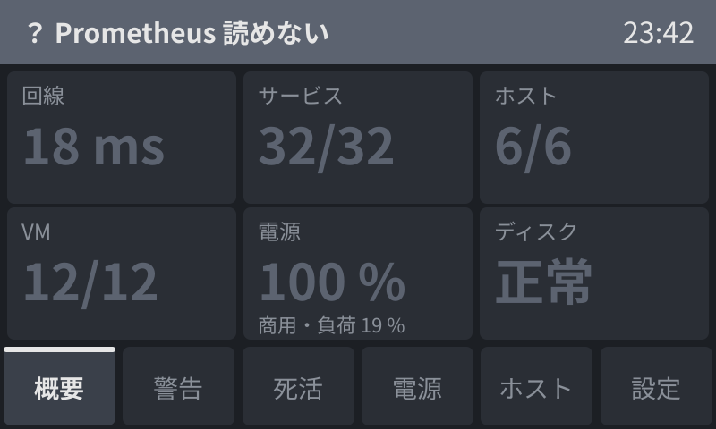

# M02 監視のタッチパネル

> **更新日** 2026-10-15 ・ **区分** 開発計画 ・ **読む人** 開発者

tarakoserver（Raspberry Pi 4）につないだ小さなタッチパネルに、家の監視の状態を出す専用の表示アプリを、フルスクラッチで作る。公共の場所にある専用の案内板のように、この表示以外には何もできない端末にする。

## 決まっていること

| 項目 | 決定 |
| --- | --- |
| 作り方 | フルスクラッチ。既製のダッシュボード（Grafana など）を映す方式は採らない |
| 描画 | LVGL（C）。ドライバーは DRM（`card1-DSI-1`）か fbdev と evdev |
| Grafana の流用 | Grafana のダッシュボード JSON（`stacks/monitoring/grafana/provisioning/dashboards/`）を配備のときに小さい設定へ変換し、詳細のページに使う。Grafana には描かせない |
| ブラウザー | 使わない（Chromium・WPE/Cog などを常駐させない） |
| メモリ | 表示のためにメモリを大きく使わない。Chromium のような重いソフトの常駐は不可 |
| 操作 | タッチで操作できる。文字の入力はしない |
| ログイン | 画面からはログインしない。データは同じ機械の中から読む |
| 閉じ込め | 表示アプリ以外の画面（デスクトップ、端末、別のアプリ、外部のサイト）へ出られない。落ちたら自動で表示に戻る |
| 言語 | 画面の文言は日本語。画面に説明文を置かない（見出し・値・状態だけ） |

## 実機

| 項目 | 値 |
| --- | --- |
| 本体 | Raspberry Pi 4 Model B（Rev 1.5、メモリ 4GB、arm64） |
| OS | Raspberry Pi OS Lite（Debian 13 trixie、arm64、カーネル 6.18）。デスクトップ・X・Wayland は入っていない |
| 画面 | OSOYOO 5 インチ DSI タッチスクリーン（公式 7 インチの互換として `display_auto_detect=1` で自動で検出される）。800×480、約 108×65mm（1mm あたり約 7.4px）。DRM: `card1-DSI-1`、`/dev/fb0`（16 ビット） |
| 明るさ | `/sys/class/backlight/10-0045`（0〜255） |
| タッチ | `generic ft5x06`（I2C、`10-0038`、evdev）。静電容量式、10 点。座標は画素と同じ（0〜799、0〜479）で、合わせ込みは要らない（2026-10-14 に四隅で確認） |
| 起動ディスク | SD カード（2026-10-14 に USB メモリから移した）。**書き込みを減らす**ため、表示アプリはディスクに書かない（ログは journald がメモリに置く。設定は読むだけ） |
| データ用ディスク | HDD（`/srv`、ext4、`LABEL=tarako-data`）。必要なら書いてよいが、無くても表示は動くこと |
| 同居するもの | Prometheus・Alertmanager・Grafana・blackbox・pve/nut exporter（Docker、`stacks/monitoring/`）、Caddy、ネットワーク図（`stacks/netmap/`） |

## データの取り方

すべて同じ機械の中（`127.0.0.1`）から、認証なしの HTTP で読む。外部への通信はしない。

| 入手先 | URL | 使い道 |
| --- | --- | --- |
| Prometheus | `http://127.0.0.1:9090/api/v1/query`（`query_range` も） | 値・死活・時系列 |
| Alertmanager | `http://127.0.0.1:9093/api/v2/alerts` | 今出ている警告の一覧 |

Prometheus の収集対象（`stacks/monitoring/prometheus/prometheus.yml`）:

| job | 中身 | 使える値の例 |
| --- | --- | --- |
| `node` | 各ホストの node_exporter（`node-targets.yml`：K11・core-01・cloud-01・tarakoserver・apps-01・web-01 など） | `up`、`node_load1`、`node_memory_MemAvailable_bytes`、`node_filesystem_avail_bytes`、`node_hwmon_temp_celsius`／`node_thermal_zone_temp` |
| `blackbox` | 公開・内部の URL の到達（`blackbox-targets.yml`、`https_reachable`） | `probe_success`、`probe_duration_seconds`、`probe_ssl_earliest_cert_expiry` |
| `pve` | Proxmox（K11）の VM とノード | `pve_up`、`pve_cpu_usage_ratio`、`pve_memory_usage_bytes` |
| `nut` | UPS（K11 の NUT） | `network_ups_tools_battery_charge`、`network_ups_tools_ups_status`、`network_ups_tools_ups_load` |
| `game` | game-01 のメトリクス | 必要なら |
| `prometheus` | Prometheus 自身 | — |

警告（`alerts.yml`）: ServiceProbeFailed、CertificateExpiringSoon、NodeExporterDown、NodeFilesystemAlmostFull、NodeMemoryLow、NodeOOMKill、NodeSystemdUnitFailed、NodeRebooted、CloudBackupMetricMissing、CloudBackupStale、BulkDiskUnmounted、BulkDiskAlmostFull、BulkAreaAlmostFull、SmartDeviceUnhealthy、SmartDeviceInactive、SmartSectorErrors、SmartCableErrors、SmartTemperatureHigh、SmartCollectorStale、NvmeWearHigh、Watchdog（常に鳴っている生存確認。表示から除く）、ProxmoxGuestDown、ProxmoxNodeMemoryHigh、UpsOnBattery、ProxmoxNodeDiskAlmostFull。

正確な系列名は実機の Prometheus で `/api/v1/label/__name__/values` を見て確かめる。

## 画面の設計

### 従う指針

| 指針 | 取り入れること |
| --- | --- |
| ISA-101（High Performance HMI） | 色は異常にだけ使い、正常は灰色の濃淡で描く。緑で「正常」を塗らない。概要 → 一覧 → 詳細の 3 階層にする |
| ISA-18.2／IEC 62682（警報の管理） | 警告は対処が要るものだけにする。出っぱなしの警告を置かない（下の「警告の整理」）。重さは「注意」「危険」の 2 段。新しい警告は「確認」を押すまで目立たせる |
| タッチの大きさ（Apple HIG 44pt≒7mm、Material 48dp≒9mm、公共の端末は 15mm 前後） | 触る所はどれも 88px（約 12mm）以上・隣と 8px 以上離す |
| WCAG 2.2（1.4.1・1.4.3・2.5.8） | 色だけに頼らず、形と文字を必ず添える。文字と背景のコントラストは 4.5:1 以上 |
| 案内板・キオスクの通例 | スクロールとジェスチャーを使わない。しばらく触らなければ最初の画面へ戻る。どの画面にも同じ場所に同じ操作がある |

### 割り付け（800×480）

| 領域 | 位置（y） | 中身 |
| --- | --- | --- |
| 状態の帯 | 0〜72 | 全体の状態（異常なし・注意 n・危険 n・読めない）、いちばん重い警告の名前、「確認」、時刻。帯を触ると警告のページへ移る |
| 本文 | 72〜384 | ページの中身。どのページもスクロールしない |
| 切り替え | 384〜480 | 概要・警告・死活・電源・ホスト・設定の 6 つのボタン（各 133×96）。異常のあるページのボタンに件数の印を付ける |

88px は約 12mm、96px は約 13mm。実機で押し比べ、押しやすい最小は 88px だった。

### 文字

| 用途 | 大きさ |
| --- | --- |
| 概要のタイルの値 | 56px（太字） |
| 状態の帯 | 32〜36px |
| ボタン・一覧の行の名前 | 28px |
| ラベル・補助の値（最小） | 20〜24px |

- 数字は等幅にして右か左にそろえ、桁数を固定する（% は整数、バイトは小数 1 桁）。
- 経過時間は「12分」「3時間」「4日」の形にする。
- フォントは IPAex ゴシックか Noto Sans CJK JP。

### 色と形

| 状態 | 色 | 形 | 文字 |
| --- | --- | --- | --- |
| 正常 | 灰（文字 `#e6e6e6`、面 `#2a2e35`） | なし | 値だけ |
| 注意（`severity: warning`） | 黄 `#f2b600`（帯の上の文字は黒） | ▲ | 注意 |
| 危険（`severity: critical`） | 赤 `#e53935`（帯の上の文字は白） | ◆ | 危険 |
| 読めない・古い | 暗い灰 `#5c6370` | ？ | 読めない |

背景は `#1c1f24`。焼き付きと眩しさを抑える暗い色にする。動き（点滅）は「確認」前の新しい警告だけに使う。

### ページと階層

| 階層 | ページ | 中身 | 入手先 |
| --- | --- | --- | --- |
| 1 | 概要 | 回線・サービス・ホスト・VM・電源・ディスクの 6 枚のタイル（各 256×148）。タイルを触ると対応する 2 階層目へ移る | このアプリの設定 |
| 2 | 警告 | 警告を名前ごとにまとめた行（高さ 70px、4 行まで）。重い順、同じ重さなら新しい順。右に ▲▼ のページ送り（各 96×148） | Alertmanager |
| 2 | 死活 | 回線・サービス・ホスト・VM の一覧。異常を先頭に並べ、正常は「正常 31」のように数だけにまとめる。「全部」を押すと 3 列 × 4 行で全件を出す | Prometheus（`probe_success`・`up`・`pve_up`） |
| 2 | 電源 | 電池の残り（大きく）、商用電源か停電中か、負荷、残り時間、入力電圧 | Prometheus（`network_ups_tools_*`） |
| 2 | ホスト | ホストごとのカード（3 × 2）。CPU・メモリ・ディスク・温度の横棒。カードを触るとそのホストの詳細へ | Prometheus（`node_*`） |
| 3 | 詳細 | 上に「◀ 戻る」と ◀▶ のページ送り（各 120 以上 × 64）。stat は 4 枚を 1 列に、timeseries は 1 ページに 1 つを幅いっぱいに、table は上から 5 行 | Grafana のダッシュボードから変換 |

| 概要のタイル | 触ったときの行き先 |
| --- | --- |
| 回線・サービス・VM | 死活（その種類の所） |
| ホスト | ホスト |
| 電源 | 電源 |
| ディスク | K11 のストレージの詳細（`storage.json`） |

### 操作の決まり

- 押した瞬間に押した見た目へ変え、**指を離したときに決める**。押してから 24px 以上動いたら取り消す。
- **使わないもの**：スワイプ・長押し・ダブルタップ・ピンチ・スクロール・文字の入力。指が複数触れたときは、最初の 1 点だけを使う。
- ページ送りはボタンだけで行う。押せないときは灰色にする。
- ページが変わった直後の 300ms は入力を捨てる（二度押しとチャタリングを防ぐ）。
- 60 秒触らなければ概要へ戻る。
- **確認**
  - 新しい警告が出ると、帯が 1 秒周期で 10 秒点滅し、その後も「確認」を押すまで帯に「確認」を出す。
  - 確認はこのパネルの中だけの記録で、Alertmanager の消音はしない。
  - アプリが起き直したときは、その時点の警告を確認済みとして扱う（落ちて戻るたびに点滅させない）。

### 明るさ

- 時刻で振る舞いを変えない。明るさは利用者が「設定」のページで選ぶ。
- 「設定」のページにあるもの（どれも大きなボタンで選ぶ。文字は入れない）：

  | 項目 | 選べる値 | 初期値 |
  | --- | --- | --- |
  | 明るさ | 25・50・75・100 % | 100 % |
  | 暗くなるまで | 1分・5分・30分・無制限 | 無制限 |
  | 暗くなったとき | 消す・10 % | 10 % |

- 選んだ値は `/srv`（HDD）に置いて起き直しても残す。HDD が無いときは初期値で動く。SD カードには書かない。
- 暗い・消えているときの最初のタッチは明るくするだけにして、ボタンには渡さない。
- 新しい「危険」が出たら明るくする。
- 明るさは `/sys/class/backlight/10-0045/brightness` で変え、消すときは `bl_power` を使う。

### 焼き付き

- 液晶でも、同じ絵を長く出し続けると残像（焼き付き）が出る。
- 帯と切り替えのボタンを含む画面全体を、10 分ごとに上下左右へ 2px ずつずらして描く。
- 背景は暗い色にし、明るい色の面を常に同じ場所へ出さない。

### データの鮮度

- Prometheus は 15 秒ごと（`scrape_interval` は 30 秒）に、Alertmanager は 10 秒ごとに読む。1 回の読み取りは 3 秒で打ち切る。
- 値ごとに読めた時刻を持つ。2 回続けて読めなければ、前の値を暗い灰で残し、帯を「読めない」にする。
- 時刻を出していることが、アプリが生きている印になる。固まったときは systemd の `WatchdogSec` で起き直す。

### 名前

| 対象 | 画面に出す名前 | 入手先 |
| --- | --- | --- |
| ホスト | `core-01`・`K11`（`apextox` は K11 と出す）など | `node_uname_info` の `nodename`。IP は出さない |
| VM | `media-01` など | `pve_guest_info` の `name` |
| サービス | `awx`・`kavita` など | blackbox の `instance` の URL のホスト名の先頭 |
| 警告 | 「サービス応答なし」など | `alerts.yml` の `annotations.panel` |

### Grafana からの変換

- **対象**：タグ `panel` を付けたダッシュボードだけを変換する。
- **並び**：`gridPos` の (y, x) の順で並べ、位置と大きさは使わない。
- **使う値**：`title`、`targets[].expr`、`legendFormat`、単位（`percentunit`・`percent`・`bytes`・`decbytes`・`celsius`・`s`・`none`）、しきい値。しきい値の色は、緑を正常、黄と橙を注意、赤を危険に読み替える。
- **未対応のもの**：変数・transformations・`$__rate_interval` などを使うパネルは、変換のときに失敗させる（黙って省かない）。`game-server.json` は変数を使っているので、対象にするときは別に決める。
- **確かめ方**：変換は Python で書き、`tests/` に今ある 5 枚の変換のテストを置く。

### 警告の整理

2026-10-14 の実機では、Watchdog を除いて 13 件の警告が出たままだった。このままではパネルが常に「注意」になり、本当の異常が埋もれる。2026-10-15 に次のとおり直して配備した。

| 警告 | 原因 | 対応 |
| --- | --- | --- |
| ProxmoxGuestDown（5 件） | わざと止めている VM（k8s の 3 台・win-01・router-01・probe-01） | 自動起動の VM とノードだけを見る（済） |
| ServiceProbeFailed（awx） | k8s を必要なときだけ動かしている | k8s-cp-01 が動いているときだけ見る（済） |
| NodeSystemdUnitFailed（`openipmi.service`、6 台） | node_exporter の推奨パッケージで入った openipmi が、IPMI の無い機械で失敗する | `platform/ansible/tasks/disable-openipmi.yml` で止める（済） |
| NodeSystemdUnitFailed（K11 の `iperf3-measure`） | 一時的な計測の残り（transient unit） | 失敗の記録を消した（済） |
| NodeSystemdUnitFailed（apps-01 の `eufy-camera-watch`） | `camera_watch.py` が HTTP 404 で失敗する | 未対応 |
| NodeSystemdUnitFailed（tarakoserver の `smartmontools`） | USB の HDD を smartd が見つけられない | 未対応 |
| UpsOnBattery | ラベル名の誤り（`value` → `flag`）で、停電しても鳴らなかった | 直した（済） |

警告ごとの画面用の名前は `alerts.yml` の `annotations.panel` に置いた。

### 画面の例

| 概要（異常なし） | 概要（注意） |
| --- | --- |
|  |  |

| 警告 | 詳細（Grafana の `host.json` から変換） |
| --- | --- |
|  |  |

| Prometheus が読めない |
| --- |
|  |

## 配備の決まり

- コードは `stacks/` または Ansible のロールに置き、`platform/ansible/` から tarakoserver へ配備する（`monitoring` グループ、鍵は `~/.ssh/id_ed25519_shake`）。手で入れない。
- systemd のサービスとして起動時に自動で立ち上げ、落ちたら再起動する。表示以外のログイン画面（tty の getty）は画面に出さない。
- 依存（ライブラリ・パッケージ）を足すときは、理由を添えて提案し、了承を得てから入れる（README「改善の提案」）。
- 画面の電源・明るさの制御が要るなら、それも同じ配備に含める。

## 受け入れの目安

- 電源を入れると、何も操作せずに表示が出る。
- タッチだけで全ページを行き来でき、表示以外へ出る操作が無い。
- Prometheus や Alertmanager が止まっていても落ちず、「読めない」ことを表示する。
- 常駐のメモリが小さい（目安は数十 MB 以内）。SD カードへ書かない。
- 24 時間動かし続けて、メモリが増え続けない。
- 触る所はどれも 88px 以上で、指を離したときに決まる。消えている画面への最初のタッチでは何も押されない。
- 60 秒触らなければ概要へ戻る。明るさの設定が起き直しても残る。新しい警告は帯の点滅と「確認」で分かり、確認すると点滅しなくなる。
- 画面に IP アドレスや英語の警告名を出さない。

## 関連

- [M01 監視（Prometheus・Grafana）](M01-monitoring.md)
- 監視の配備: `platform/ansible/monitoring.yml`、`stacks/monitoring/`
- Raspberry Pi の土台: `platform/ansible/roles/pi_base/`（journald はメモリ・SD の書き込み削減）
