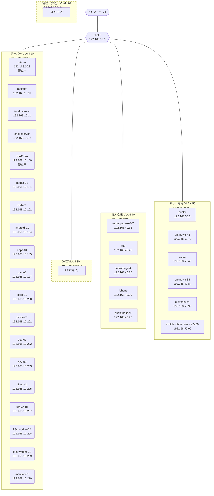

# ネットワーク図

> **更新日** 2026-10-14 ・ **区分** 入口 ・ **読む人** 全員

<!-- tools/render-network-map.py が network.yaml と NetBox から作る。手で編集しない。 -->

| 形 | 意味 |
| --- | --- |
| 四角 | 物理の機器 |
| 角丸 | VM |
| 点線の枠 | 未作成・予約 |

区画間の通信は [VLAN 分離](operations/vlan.md)、Flint 3 の設定は [Flint 3](operations/flint3.md)。
