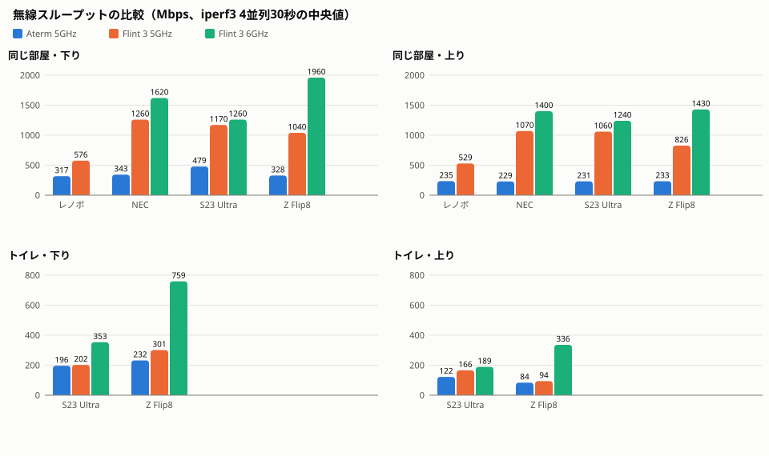

# Aterm と Flint 3 の無線性能比較

2026-10-13 に、Aterm WG1200HP4（Wi-Fi 5）と Flint 3（GL-BE9300、Wi-Fi 7）を同じ端末・同じ場所で測った記録。

## 結果（Mbps、上り／下り）

| 端末 | 地点 | Aterm 5GHz | Flint 3 5GHz | Flint 3 6GHz |
| --- | --- | --- | --- | --- |
| レノボ（AC 9560、Wi-Fi 5） | 同じ部屋 | 235／317 | 529／576 | 非対応 |
| NEC（AX210、Wi-Fi 6E） | 同じ部屋 | 229／343 | 1070／1260 | 1400／1620 |
| S23 Ultra | 同じ部屋 | 231／479 | 1060／1170 | 1240／1260 |
| Z Flip8 | 同じ部屋 | 233／328 | 826／1040 | 1430／1960 |
| S23 Ultra | トイレ | 122／196 | 166／202 | 189／353 |
| Z Flip8 | トイレ | 83.9／232 | 93.6／301 | 336／759 |

- Aterm の上りは全端末で 230 Mbps 前後に揃い、Aterm 側が上限だった。Flint 3 では端末の差がそのまま出る。
- 同じ部屋では Flint 3 が 2〜6 倍。Wi-Fi 5 のレノボでも 160MHz 幅で約 2 倍。
- 遠い場所では 5GHz の差がほぼ消える（1.0〜1.4 倍）。6GHz は遠くでも 1.5〜4 倍。
- Flint 3 の 2.4GHz は同じ部屋で 76〜232 Mbps、トイレで 10〜76 Mbps。家電専用にする。
- 有線は律速していない（Flint 3 ↔ apextox は 2.35 Gbps、最高値は 1960 Mbps）。

## 条件

| 項目 | 値 |
| --- | --- |
| 測定 | `iperf3 -c 192.168.10.10 -t 30 -P 4`（上り）と `-R`（下り）。サーバーは apextox 本体 |
| 経路 | Aterm: 端末 → Aterm → TL-SG605（1G）→ apextox。Flint 3: 端末 → Flint 3 →（2.5G 直結）→ apextox |
| Flint 3 の電波 | 5GHz は ch36・160MHz、6GHz は ch85・320MHz、2.4GHz は ch6・40MHz。AP 構成 |
| Aterm の電波 | 5GHz ch36 |
| 回数 | PC は 3 回の中央値、スマホは 1 回 |

## 限界

- スマホは各条件 1 回で、ばらつきは評価できない。
- Flint 3 の計測中も Aterm は電波を出していて、5GHz は同じ ch36 だった。Flint 3 の 5GHz は実力より低く出ている可能性がある。
- 「壁 1 枚隔てた部屋」と「同時接続」は測っていない。
- NEC は `netsh` から無線の情報（チャネル・リンク速度・RSSI）が取れず、帯域は測定の順番と Flint 3 側の接続記録から付けた。
- レノボの最初の 6 回は Tailscale 経由になっていたので除外した（家の中でも LAN 宛てが VPN を通る。[Flint 3](../../docs/operations/flint3.md) の「家の中で遠回りになる場合」）。

## ファイル

| ファイル | 内容 |
| --- | --- |
| `results-server.csv` | iperf3 サーバー側のログから起こした全 74 件。スマホの帯域は Flint 3 の接続記録と突き合わせた |
| `results-lenovo.csv`・`results-nec.csv` | PC 側の記録（負荷中の ping、リンク速度、RSSI を含む） |
| `measure.ps1` | Windows 用の計測スクリプト。Tailscale 経由なら止まる |
| `plot.py` | `results-server.csv` から `comparison.svg` を作る |
